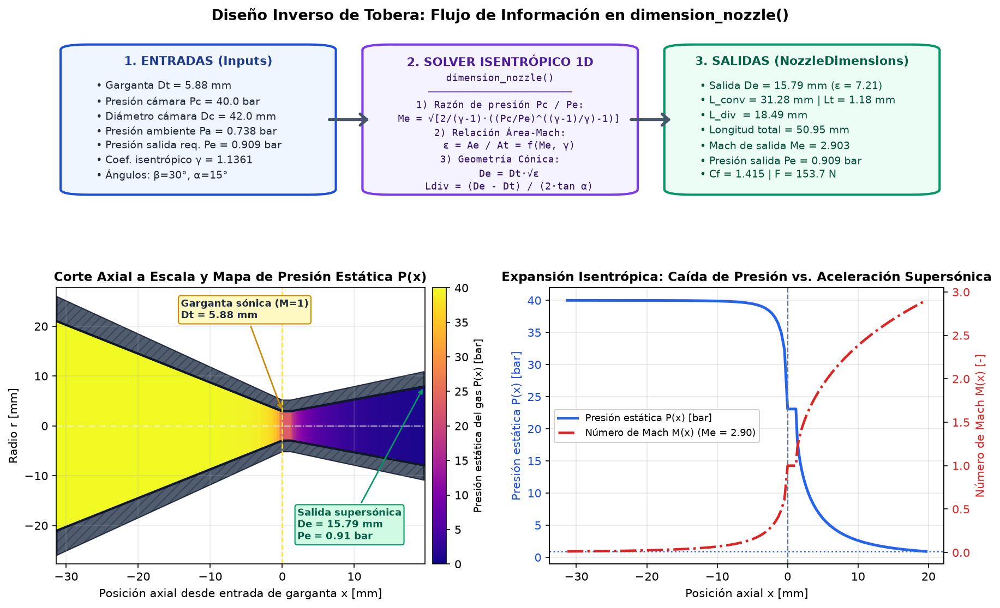

# PropulPy

**Rocket motor design and inverse design, built to complement [RocketPy](https://github.com/RocketPy-Team/RocketPy).**

*Diseño y diseño inverso de motores cohete, como complemento de RocketPy.*

RocketPy answers *"how does this rocket fly with this motor?"*.
PropulPy answers the inverse question: **"which motor — with exact dimensions — do I need to meet my goals?"**

| Layer | What it does |
|---|---|
| **Forward model** | Design (propellant, grains, nozzle, chamber) → `F(t)`, `Pc(t)`, `ṁ(t)`, `m(t)`, ready for RocketPy |
| **Inverse design** | Objectives + constraints (apogee, impulse, Isp, exit pressure, thrust profile, manufacturing limits) → grain, nozzle and chamber geometry |

Ambient conditions come from a `rocketpy.Environment`, so motors can be
evaluated at any launch site and date.

> ⚠️ **Pre-alpha.** Foundations only (v0.1 in progress). APIs will change.

## Status

| Module | State |
|---|---|
| `nozzle.isentropic`, `ConicalNozzle` | ✅ |
| `Propellant`, `SaintRobert`, `PiecewiseSaintRobert`, `KNSB` | ✅ |
| `grains.BATES`, `EndBurner`, `Finocyl`, `Star`, `Chamber` | ✅ |
| `AmbientConditions` (float or `rocketpy.Environment`) | ✅ |
| `SolidMotor.simulate()`, `SolidMotor.from_ric()`, `MotorResults`, `to_rocketpy()`, `.eng`/`.ric`/`.csv` export | ✅ |
| `analysis.checks` (`check_motor_design`, safety audit) | ✅ |
| `design.nozzle` (`dimension_nozzle`, trajectory optimization) | ✅ |
| `flight` & `design.mission` (`MotorRequirements`, RocketPy apogee check, `find_grain_length_for_apogee`) | ✅ |
| `cad` (`MotorGeometryBuilder`, parametric 3D STEP AP214 & STL export via CadQuery) | ✅ |

## Quick start

```bash
git clone https://github.com/UltraLuminics/PropulPy.git
cd PropulPy
pip install -e ".[dev]"
pytest
```

```python
from propulpy import BATES, KNSB, AmbientConditions
from propulpy.nozzle import ConicalNozzle

prop = KNSB(cstar_efficiency=0.95)
grain = BATES(diameter=38e-3, core_diameter=12.5e-3, length=62e-3)
nozzle = ConicalNozzle(throat_diameter=5.88e-3, exit_diameter=13.8e-3, efficiency=0.90)

kn = 2 * grain.burn_area(0.0) / nozzle.throat_area
pc = prop.equilibrium_pressure(kn)
pa = AmbientConditions(101325.0).ground_pressure
print(
    f"Kn = {kn:.1f}, Pc = {pc / 1e5:.1f} bar, F = {nozzle.thrust(prop.k, pc, pa):.1f} N"
)
```

## Interactive Example Notebooks (`examples/`)

- **[`examples/quickstart_ultraluminics.ipynb`](examples/quickstart_ultraluminics.ipynb)**: Step-by-step interactive walkthrough of **Level 1 Nozzle Inverse Design (`dimension_nozzle`)**, pressure-expansion regimes & Summerfield separation criteria, 1D/2D Euclidean Distance Transform (`EDT`) grain geometries (`BATES`, `Finocyl`, `Star`, `EndBurner`), quasi-steady firing simulation with blowdown, and one-line `RocketPy` / `openMotor` (`.ric` & `.eng`) integration.
- **[`examples/srad_38mm_pipeline.ipynb`](examples/srad_38mm_pipeline.ipynb)**: Complete **Mission-to-CAD Pipeline** (`SRAD 38 mm KNSB`), featuring apogee bisection inverse search (`find_grain_length_for_apogee`), stepped-core 5-grain internal ballistics audit (`[16, 17, 18, 19, 20] mm`), 6-DOF `RocketPy` flight verification, and parametric 3D `STEP` generation (`MotorGeometryBuilder`).



## Units

SI everywhere internally (m, Pa, kg, s). Helpers in `propulpy.units` convert at the boundaries.

## Contributing

See [CONTRIBUTING.md](CONTRIBUTING.md). Developed by **UltraLuminics**, Universidad Nacional de Colombia, inspired by the work of Projeto Jupiter (USP) on RocketPy.

## License

[MIT](LICENSE)
