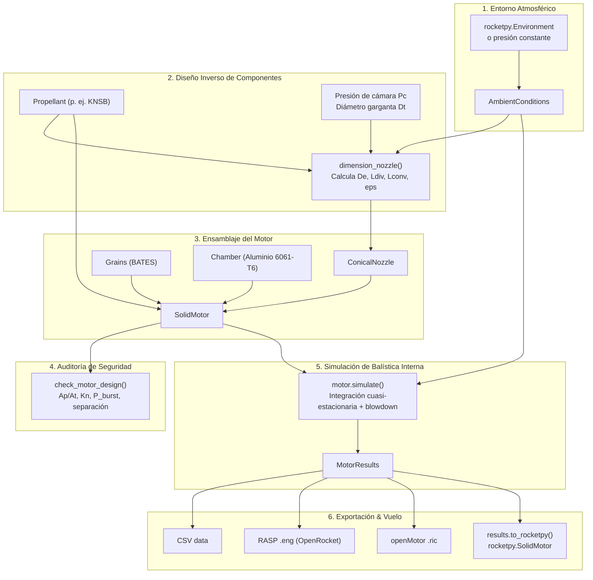

# Documentación Oficial de PropulPy

**PropulPy** es una librería científica de código abierto en Python para el **diseño directo e inverso de motores cohete**, concebida por el grupo de investigación estudiantil **UltraLuminics** de la **Universidad Nacional de Colombia**.

El proyecto nace con la firme determinación de construir una herramienta al nivel y calibre de lo que **Projeto Jupiter** (Universidad de São Paulo) logró con [RocketPy](https://github.com/RocketPy-Team/RocketPy), abordando la propulsión espacial desde la arista complementaria:

> **RocketPy** responde: *«Dado este cohete y este motor, ¿cómo vuela y cuál es su trayectoria?»*  
> **PropulPy** responde la pregunta inversa: *«Dados los objetivos de mi misión (apogeo, empuje, impulso, presión y entorno de lanzamiento), ¿qué motor —con cotas exactas de granos, cámara y tobera— debo fabricar para alcanzarlos?»*

---

## Estructura de la Documentación

```
docs/
├── index.md                     # Esta página principal
├── getting_started/
│   ├── installation.md          # Instalación, entornos y dependencias
│   └── quickstart.md            # Tutorial guiado paso a paso con código
├── theory/
│   ├── internal_ballistics.md   # Física de combustión, equilibrio Kn y regresión BATES
│   ├── gas_dynamics.md          # Gasodinámica isentrópica 1D, expansión y tobera
│   └── structural_mechanics.md  # Mecánica de materiales del casing (esfuerzo de aro)
└── modules/                     # Referencia exhaustiva de cada archivo y función
    ├── constants_and_units.md   # constants.py y units.py
    ├── environment.md           # environment.py (Integración RocketPy)
    ├── propellants.md           # propellants/ (burn_rate.py, propellant.py, library.py)
    ├── grains.md                # grains/ (base.py, bates.py)
    ├── nozzle.md                # nozzle/ (isentropic.py, nozzle.py)
    ├── chamber.md               # chamber.py (Casing y límites mecánicos)
    ├── motor.md                 # motor.py (Ensamblaje SolidMotor)
    ├── simulation.md            # simulation/ (quasi_steady.py)
    ├── results.md               # results.py (MotorResults, exportadores, RocketPy)
    ├── analysis.md              # analysis/ (checks.py auditoría de seguridad)
    └── design.md                # design/ (nozzle.py diseño inverso)
```

---

## Flujo de Trabajo en PropulPy



---

## Tabla de Contenidos

```{toctree}
:maxdepth: 2
:caption: Primeros Pasos

getting_started/installation
getting_started/quickstart
```

```{toctree}
:maxdepth: 2
:caption: Fundamentos Teóricos

theory/internal_ballistics
theory/gas_dynamics
theory/structural_mechanics
```

```{toctree}
:maxdepth: 2
:caption: Referencia de Módulos (File by File)

modules/constants_and_units
modules/environment
modules/propellants
modules/grains
modules/nozzle
modules/chamber
modules/motor
modules/simulation
modules/results
modules/analysis
modules/design
```
