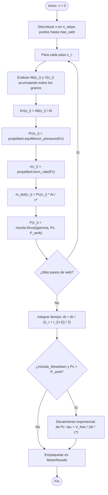

# Módulo: Simulación Numérica (`simulation/`)

Archivo fuente: `propulpy/simulation/quasi_steady.py`

El motor de simulación de PropulPy implementa una integración numérica cuasi-estacionaria precisa, tomando la coordenada de regresión del web $x$ como la variable independiente de integración.

---

## Función `simulate_quasi_steady`

```python
def simulate_quasi_steady(
    propellant: Propellant,
    grains: list[Grain],
    nozzle: ConicalNozzle,
    chamber: Chamber | None = None,
    ambient_pressure: float = 101325.0,
    n_steps: int = 500,
    include_blowdown: bool = True,
) -> MotorResults
```

---

## Algoritmo de Integración



### 1. Espesor Máximo del Web
Se identifica el espesor máximo a quemar $w = \max_i (\text{grain}_i.web\_thickness)$ y se discretiza en $N$ nodos equidistantes $x_0 = 0, x_1, \dots, x_{N-1} = 0.9995 \cdot w$.

### 2. Suma Geométrica de Granos
En cada nodo $x_j$, se suma el área activa de combustión de todos los segmentos:
$$A_b(x_j) = \sum_{k=1}^{N_g} A_{b, k}(x_j)$$
$$V_p(x_j) = \sum_{k=1}^{N_g} V_{p, k}(x_j)$$

### 3. Presión y Tasa de Regresión
Se calcula $K_n(x_j) = A_b(x_j) / A_t$. La presión de equilibrio $P_c(x_j)$ se determina por balance de masa, y de ella se evalúa la velocidad de quemado local $r(x_j) = a \cdot P_c(x_j)^n$.

### 4. Integración del Tiempo
Puesto que $r = \frac{dx}{dt}$, el diferencial de tiempo para avanzar entre dos nodos consecutivos se calcula con la regla del trapecio:
$$\Delta t_j = \frac{x_{j+1} - x_j}{\frac{r(x_j) + r(x_{j+1})}{2}}$$
$$t_0 = 0, \quad t_{j+1} = t_j + \Delta t_j$$

### 5. Despresurización (*Blowdown*)
Al alcanzar el agotamiento del propelente ($x \to w$), el gas a alta presión residual en la cámara se descarga a través de la tobera. PropulPy calcula la constante de tiempo $\tau = \frac{V_{libre}}{A_t \cdot c^*}$ y simula la caída exponencial de presión hasta igualar la atmosférica exterior.
